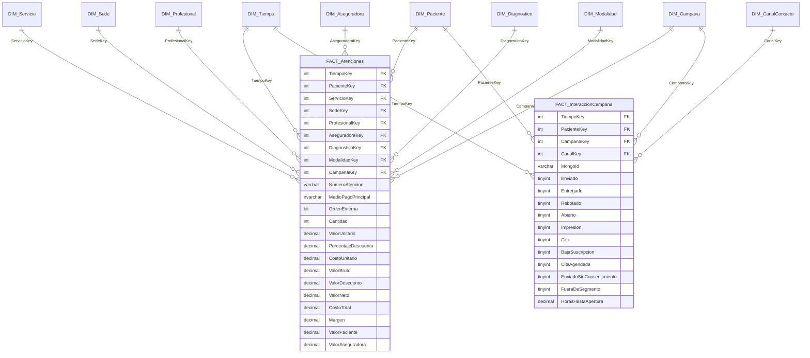

# Modelo dimensional — CLINICABI_DW_Grupo1

Insumo para el documento técnico (secciones "Diagrama del modelo estrella" y "Granularidad").
El diagrama se puede exportar a imagen con https://mermaid.live o con la vista de diagrama de SSMS.

## Diagrama

## Granularidad

| Tabla | Una fila por… | Origen |
|---|---|---|
| FACT_Atenciones | servicio prestado en una atención **Realizada** (línea de `DetalleAtencion`) | OLTP (+ campaña atribuida T21) |
| FACT_InteraccionCampana | interacción paciente–campaña (documento **único** de `interacciones_campanas`, tras T16) | MongoDB |
| DIM_Tiempo | día (clave AAAAMMDD) | generada (T10) |
| DIM_Paciente | paciente | OLTP + perfil vigente de MongoDB |
| DIM_Servicio / Sede / Profesional / Aseguradora / Diagnostico / Modalidad | una fila por entidad del OLTP | OLTP |
| DIM_Campana | campaña | MongoDB `campanas` |
| DIM_CanalContacto | canal (email, sms, whatsapp, app) | catálogo estandarizado (T16) |

**Dimensiones conformadas** (compartidas por los dos hechos): DIM_Tiempo, DIM_Paciente y DIM_Campana.
Esto permite cruzar en un mismo visual las atenciones con las campañas, por ejemplo la facturación atribuida frente al presupuesto.

## Reglas del diseño

- **Claves sustitutas** (`…Key`, `IDENTITY`) en todas las dimensiones, más la **clave natural** (`…ID`, `CampanaID`, `CodigoCanal`) para rastrear cada fila hasta la fuente. DIM_Tiempo usa la clave inteligente AAAAMMDD.
- **Miembro desconocido -1** en cada dimensión. Se inserta al crear el DW. Se usa en estos casos:
  - Orden externa sin profesional ni diagnóstico (T8).
  - `pacienteId` de MongoDB que no existe en el OLTP (T19).
  - Atención sin campaña atribuida (T21).
- **Dimensiones degeneradas** en los hechos: NumeroAtencion, MedioPagoPrincipal, OrdenExterna, MongoId y Dispositivo. Son atributos de la transacción que no justifican una tabla propia.

## ¿Por qué estrella y no copo de nieve?

1. **Simplicidad de consulta:** cada pregunta se resuelve con un solo JOIN de hecho a dimensión. Las jerarquías (País → Región → Departamento → Ciudad, Línea → Tipo → Servicio, Tipo de afiliación → Aseguradora) quedan aplanadas dentro de una sola tabla.
2. **Power BI:** el motor está optimizado para estrella. Las relaciones son 1:N directas con filtro en una sola dirección y no hay cadenas de dimensiones que propaguen filtros. Los segmentadores (región, línea) filtran directamente al hecho.
3. **Rendimiento:** hay menos joins y los índices son más simples. La redundancia de texto es mínima, porque las dimensiones son pequeñas (≤ 6.000 pacientes, 99 servicios, 15 sedes).
4. **Comprensión del negocio:** cada dimensión representa un concepto completo (la sede con su ciudad y región), lo que facilita el uso por parte de la gerencia.

El copo de nieve solo conviene cuando las dimensiones son enormes y muy jerárquicas, o cuando se comparten subdimensiones que cambian a menudo. No es el caso aquí.
